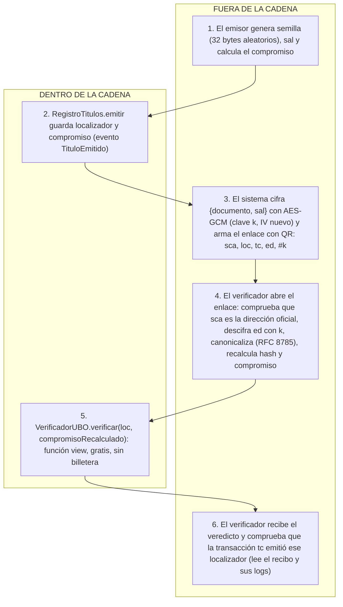

# Hito 1, Módulo C (Bloque 3): Verificación y enlace

Equipo: Noé GUENGANT, Malo KERAUTRET, Lukas LAUDRAIN, Alex FOUGEROUX

Entrega: lunes 12 de octubre. Presentación: martes 13 de octubre.
Contratos: `VerificadorUBO.verificar` (+ `verificarConExplicacion`), `HerramientasSello.byteAceptado`, `simboloDe`, `derivarLocalizador`.

## 1. Guion manual

### Tabla A: VerificadorUBO (sección 5.7 del enunciado)

Nota: `hashING = 0x0b8a7252dab48454160601ab2021f28afb4db1f0c2801c51d71eaba104107a62`, L = `0x55305a5341385150464e` (U0ZSA8QPFN).
Veredictos: 0 Valido, 1 Revocado, 2 Suspendido, 3 Inexistente, 4 EmisorNoAutorizado, 5 DocumentoAlterado.

| # | Paso | Resultado esperado | Resultado obtenido |
|---|------|--------------------|--------------------|
| 1 | Desplegar `SimRegistroEmisores` y `SimRegistroTitulos` | Se despliegan sin error | Se desplegaron ✓ (bloques 20 y 21, estado 1) |
| 2 | Desplegar `VerificadorUBO(direccionSimTitulos, direccionSimEmisores)` (primero títulos, después emisores) | Se despliega sin error; `titulos()` y `registro()` devuelven esas direcciones | Se desplegó ✓ (bloque 22). Argumentos decodificados: titulos_ = SimRegistroTitulos (0xe289…157A), registro_ = SimRegistroEmisores (0x5e17…4Eff5) |
| 3 | En SimEmisores, desde cuenta 1: `autorizarEmisor(cuenta1, hashING)` | Marca verde; `estaAutorizado(cuenta1, hashING)` = `true` | Marca verde ✓. Evento EmisorAutorizado(cuenta1, hashING, 1791856541). `estaAutorizado(cuenta1, hashING)` devolvió `true` |
| 4 | Desde cuenta 1, en SimTitulos: `emitir(L, hashING, hashPrograma, 0x…01)` | Marca verde; `obtenerTitulo(L)` muestra estado 1 y compromiso `0x…01` | Marca verde ✓. Evento TituloEmitido(L, hashING, compromiso 0x…01, emisor = cuenta1) |
| 5 | `verificar(L, 0x…01)` | `0` (Valido) | Devolvió `0` ✓ (Valido) |
| 6 | `verificar(L, 0x…02)` | `5` (DocumentoAlterado) | Devolvió `5` ✓ (DocumentoAlterado) |
| 7 | `verificar(otroLocalizadorNuncaEmitido, 0x…01)` | `3` (Inexistente), sin revertir | Devolvió `3` ✓ (Inexistente), sin revertir |
| 8 | En SimTitulos: `suspender(L, 5)`; luego `verificar(L, 0x…01)` | `2` (Suspendido) | `suspender` marca verde ✓, evento EstadoCambiado(L, 2, 5). `verificar` devolvió `2` ✓ |
| 9 | En SimTitulos: `revocar(L, 2)`; luego `verificar(L, 0x…02)` (compromiso incorrecto) | `1` (Revocado): el estado se comprueba antes que el compromiso | `revocar` marca verde ✓, evento EstadoCambiado(L, 3, 2). `verificar(L, 0x…02)` devolvió `1` ✓ (Revocado, aun con compromiso incorrecto) |
| 10 | Emitir otro título L2 como en el paso 4; en SimEmisores `fijarPeriodo(cuenta1, hashING, desde, 0)` con `desde` mayor que la fecha de emisión (p. ej. `block.timestamp + 1000000`); `verificar(L2, 0x…01)` | `4` (EmisorNoAutorizado) | `emitir(L2)` marca verde ✓ (TituloEmitido). `fijarPeriodo(cuenta1, hashING, 99999999999, 0)` marca verde ✓. `verificar(L2, 0x…01)` devolvió `4` ✓ (EmisorNoAutorizado) |

Extra (explicación, ya implementada): `verificarConExplicacion(L2, 0x…01)` en el paso 5 devuelve `(0, "Titulo valido emitido por la UBO")`.

### Tabla B: HerramientasSello (valores de la sección 5.7)

| Llamada | Resultado esperado | Por qué | Resultado obtenido |
|---------|--------------------|---------|--------------------|
| `byteAceptado(0)` | `true` | 0 < 252 | `true` ✓ |
| `byteAceptado(251)` | `true` | último aceptado | `true` ✓ |
| `byteAceptado(252)` | `false` | 252 = 7 × 36 es el primer descartado | `false` ✓ |
| `byteAceptado(255)` | `false` | 255 ≥ 252 | `false` ✓ |
| `simboloDe(0)` | `0x30` («0») | 0 % 36 = 0 | `0x30` ✓ |
| `simboloDe(9)` | `0x39` («9») | 9 % 36 = 9 | `0x39` ✓ |
| `simboloDe(10)` | `0x41` («A») | 10 % 36 = 10 | `0x41` ✓ |
| `simboloDe(35)` | `0x5a` («Z») | 35 % 36 = 35 | `0x5a` ✓ |
| `simboloDe(36)` | `0x30` («0») | 36 % 36 = 0 | `0x30` ✓ |
| `simboloDe(252)` | revierte `ByteNoAceptado(252)` | byte no aceptado | Revirtió con `ByteNoAceptado(252)` ✓ |
| `derivarLocalizador(0x00…01)` | `0x584539414149374e324d` («XE9AAI7N2M») | determinista | `0x584539414149374e324d` ✓ |
| `derivarLocalizador(0x00…01)` otra vez | igual al anterior | misma semilla, mismo resultado | `0x584539414149374e324d` ✓ (igual) |
| `derivarLocalizador(0x00…02)` | `0x53465259494f5a385133` («SFRYIOZ8Q3») | semilla distinta, localizador distinto | `0x53465259494f5a385133` ✓ |

Localizadores derivados (calculados con una implementación independiente de keccak256 comprobada contra `keccak256("ING")` del enunciado): **XE9AAI7N2M** (semilla `0x00…01`) y **SFRYIOZ8Q3** (semilla `0x00…02`).
Para pasar la semilla en Remix: `0x0000000000000000000000000000000000000000000000000000000000000001`.

---

## 2. Documento de diseño

### a) Diagrama de flujo con dos carriles

Dentro de `verificar`, el orden obligatorio es: 1) el título no existe (Inexistente), 2) el emisor no estaba autorizado en la fecha de emisión (`estabaAutorizado(emisor, facultad, fechaEmision)`), 3) Revocado, 4) Suspendido, 5) el compromiso no coincide (DocumentoAlterado), 6) Valido. Gana la primera condición que se cumple.

### b) Tabla de funciones

| Función | Visibilidad | Quién puede llamarla | Errores que puede lanzar | Evento |
|---------|-------------|----------------------|--------------------------|--------|
| `VerificadorUBO.constructor(titulos_, registro_)` | público (despliegue) | quien despliega | ninguno | - |
| `verificar` | `external view` | cualquiera, sin billetera | ninguno (devuelve veredicto) | ninguno (view) |
| `verificarConExplicacion` | `external view` | cualquiera, sin billetera | ninguno | ninguno (view) |
| `_veredicto` | `internal view` | solo el propio contrato | ninguno | - |
| `_texto` | `internal pure` | solo el propio contrato | ninguno | - |
| `byteAceptado` | `public pure` | cualquiera | ninguno | - |
| `simboloDe` | `public pure` | cualquiera | `ByteNoAceptado(b)` | - |
| `derivarLocalizador` | `external pure` | cualquiera | ninguno | - |
| `raizDeMerkle` | `external pure` | cualquiera | `ListaVacia` (pendiente, semana 2) | - |
| `hashDocumento`, `compromiso`, `hojaLote` | `external pure` | cualquiera | ninguno (ya hechas) | - |
| `AnclajeLotes.*` | - |, | pendiente, semana 2 | pendiente |

### c) Respuestas razonadas

**1. ¿Por qué se consulta `estabaAutorizado` y no `estaAutorizado`?**
Decisión: `verificar` pregunta si el emisor estaba autorizado en la fecha de emisión. Razón: si usara el presente, todos los títulos de un funcionario dejarían de ser válidos el día que cambia de cargo o se le revoca la autorización. Alternativa descartada: `estaAutorizado`, que invalida títulos legítimos ya emitidos.

**2. ¿Por qué el estado se comprueba antes que el compromiso?**
Decisión: el orden es Inexistente, EmisorNoAutorizado, Revocado, Suspendido, DocumentoAlterado, Valido. Razón: un título revocado debe dar «Revocado» aunque el documento presentado sea distinto; su situación no depende del documento. Si se comprobara el compromiso primero, un título revocado aparecería como «documento alterado» (paso 9 del guion). Alternativa descartada: comprobar el compromiso primero, que da un veredicto engañoso.

**3. ¿Por qué `verificar` es `view`?**
Decisión: no modifica estado. Razón: no cuesta gas a quien consulta ni exige billetera, que es el objetivo del proyecto. Alternativa descartada: una función que emita un evento con el veredicto, que exigiría una transacción firmada y pagada.

**4. ¿Por qué `byteAceptado` acepta solo bytes menores que 252?**
Decisión: se descartan los bytes 252 a 255. Razón: 256 = 7 × 36 + 4; con `byte % 36` sin descartar, los símbolos 0, 1, 2 y 3 recibirían 8 bytes y los otros 32 solo 7, es decir, 14 % más de probabilidad. Con 0 a 251, cada símbolo recibe exactamente 7 bytes. Alternativa descartada: `b % 36` directo (sesgo de módulo).

**5. ¿Por qué el contrato no genera el azar?**
Decisión: `derivarLocalizador` recibe una semilla de 32 bytes y la transforma de forma determinista. Razón: todo lo que ocurre en la cadena es público y reproducible; un contrato no tiene fuente de azar segura. La semilla la genera el emisor fuera de la cadena con un generador criptográfico. Alternativa descartada: usar `block.timestamp` o `blockhash`, que son predecibles o influenciables.

### d) Tabla «quién ve qué»

| Dato | Emisor | Titulado | Verificador con el enlace | Tercero que solo mira la cadena | Quien intercepta el enlace |
|------|--------|----------|---------------------------|----------------------------------|-----------------------------|
| Compromiso | Sí: lo calculó | Sí | Sí: lo recalcula y compara | Sí: es público | Sí |
| Localizador | Sí: lo generó | Sí | Sí | Sí: es público | Sí |
| Documento (nombre, carrera, fecha) | Sí | Sí | Sí: lo descifra | No: solo ve el compromiso | Sí, si captura el enlace completo; no, si solo ve lo que viaja al servidor (sin `#k`) |
| Sal | Sí: la generó | Sí (dentro del enlace) | Sí: sale al descifrar `ed` | No | Sí, con el enlace completo |
| Clave k | Sí | Sí | Sí | No: nunca está en la cadena | Sí, con el enlace completo |

Conclusión: un tercero que solo mira la cadena ve localizador, compromiso, facultad, programa, fecha, estado y emisor; puede saber que existe un título y en qué estado, pero no quién es el titulado ni qué dice el documento, porque sin la sal no puede adivinar el hash. Quien consigue el enlace completo lee todo el documento: el enlace es un título al portador. Es una decisión de diseño que se trata en el modelo de amenazas.

---

## 3. Modelo de amenazas

| # | Amenaza | Activo afectado | Cómo se ejecutaría | Impacto | Defensa | Línea de código |
|---|---------|-----------------|--------------------|---------|---------|-----------------|
| 1 | Un estafador despliega su propio contrato y genera un enlace con su dirección en `sca` | Confianza en la verificación | Registra títulos falsos en su contrato y entrega un enlace cuyo `sca` es suyo | Un empleador cree que un título falso es auténtico | El verificador compara `sca` con la dirección oficial que publica la UBO, obtenida fuera del enlace. Un contrato copiado tiene otra dirección | Fuera de la cadena: primer paso de `verificarEnlace` (script entregado); pendiente, semana 3 |
| 2 | Alguien modifica el documento cifrado del enlace | Integridad del documento | Cambia un carácter de `ed` | Documento falso presentado como auténtico | AES-GCM incluye una etiqueta de autenticación: si cambia un solo carácter, el descifrado falla. Además el compromiso recalculado no coincidiría | `verificar`: rama `DocumentoAlterado` en `_veredicto`; descifrado en el script entregado |
| 3 | El enlace se reenvía o se filtra | Confidencialidad del documento | Un tercero obtiene el enlace completo | Lee el documento: es un título al portador | Aceptable para un título de uso público; el titulado decide con quién lo comparte. Alternativas: enlaces con vencimiento, o ligar el enlace al titulado con una firma (costaría la billetera) | Diseño: la clave `#k` solo va en el fragmento; análisis completo pendiente, semana 3 |
| 4 | El localizador es predecible | Privacidad de títulos | Enumerar localizadores y consultar `verificar` | Averiguar que existen títulos y su estado; no el documento ni el titulado | El localizador no revela el documento; sin la sal no se puede adivinar el compromiso. Espacio de 36^10 ≈ 3,66 × 10^15 | `derivarLocalizador` y `HerramientasSello.ALFABETO` |
| 5 | El generador de localizadores tiene sesgo | Espacio de búsqueda efectivo | Aprovechar que los símbolos 0 a 3 son 14 % más probables con `byte % 36` | Menos entropía por símbolo, búsquedas más eficientes | Muestreo por rechazo: solo bytes < 252, cada símbolo con probabilidad exacta 1/36 | `byteAceptado`: `return b < 252;` |
| 6 | El portal de verificación es malicioso y siempre responde «válido» | Decisión del empleador | Un portal falso muestra «válido» sin consultar la cadena | Aceptar títulos falsos | El empleador repite la verificación por su cuenta: necesita `sca`, `loc`, `ed`, `k` y acceso a un nodo, y llama a la función `view` `verificar` directamente. No necesita billetera | `verificar` es `view` pública; recálculo en el script entregado |
| 7 *(propia)* | Orden incorrecto de los veredictos | Veredicto correcto | Presentar un título revocado con un documento distinto | Un título revocado se mostraría como «documento alterado» o, peor, como válido si se omite el estado | Orden fijo; el estado se comprueba antes que el compromiso. Probado en el guion, paso 9 | `_veredicto`: secuencia de `if` en ese orden |
| 8 *(propia)* | Contrato desplegado apuntando a registros falsos o con los parámetros intercambiados | Fuente de verdad del veredicto | Desplegar `VerificadorUBO` con un registro de emisores controlado por el atacante, o con el orden del constructor invertido | Veredictos manipulados o fallos silenciosos | Las direcciones son `immutable`: no se pueden cambiar después del despliegue. El orden correcto (primero títulos, después emisores) se verifica leyendo `titulos()` y `registro()` tras desplegar. La UBO debe publicar la dirección oficial del verificador | `constructor` y las variables `immutable` `titulos` y `registro` |

---

## 4. Estado de las pruebas (hito 1)

Resultado en Remix: **2 pruebas en verde** (`veredictoValido`, `documentoAlteradoUnCaracter`) y 6 en rojo con el mensaje `TODO`. La compilación de mis dos archivos no muestra errores ni advertencias.
Es el resultado del panel Solidity Unit Testing con solo `tests/ModuloC_test.sol` marcado. Las capturas están en esta carpeta.
