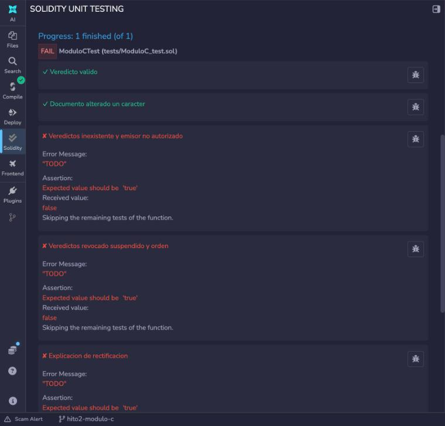
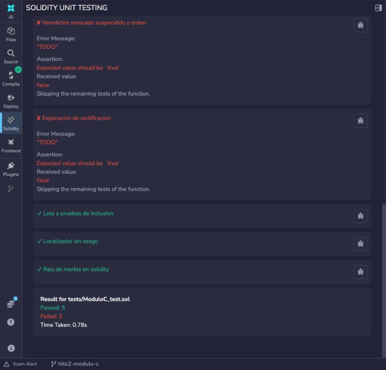
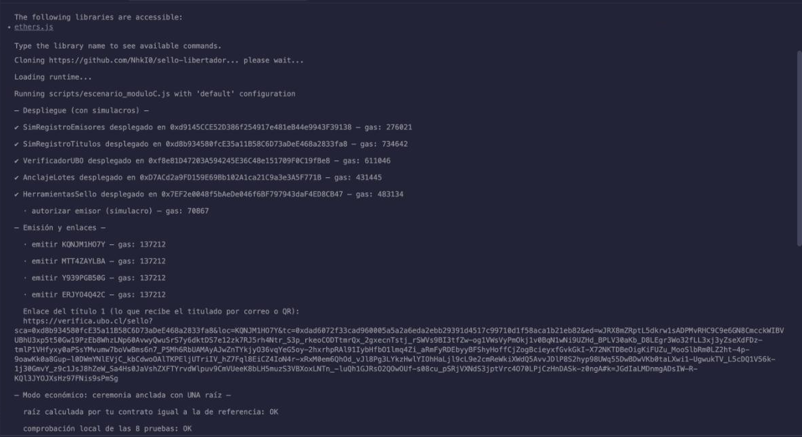
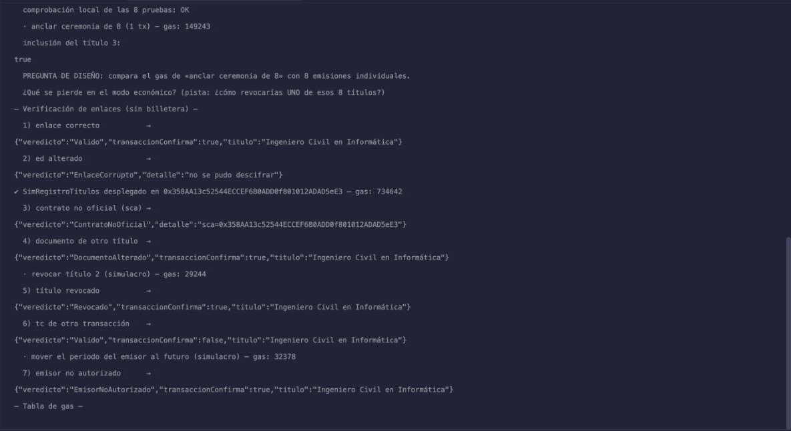

# Hito 2, Módulo C (Bloque 3): Funcionalidad completa

Equipo: Noé GUENGANT, Malo KERAUTRET, Lukas LAUDRAIN, Alex FOUGEROUX

Entrega: martes 20 de octubre (revisión del hito 2).
Contratos: `HerramientasSello.raizDeMerkle`, `AnclajeLotes.anclarLote`, `AnclajeLotes.verificarInclusion`.
Pruebas nuevas: `loteYPruebasDeInclusion`, `localizadorSinSesgo`, `raizDeMerkleEnSolidity`.

## 1. Qué se implementó en esta semana

### `HerramientasSello.raizDeMerkle(hojas)`

Calcula la raíz nivel a nivel. Cada par se combina con `_hashPar` (par ordenado, el menor primero, igual que `MerkleProof` de OpenZeppelin). Si un nivel tiene un número impar de nodos, el último sube sin emparejar. Con una hoja, la raíz es la hoja. Con cero hojas revierte con `ListaVacia()`.
Trabaja sobre una sola copia en memoria: el nodo `i` del nivel siguiente se escribe en la posición `i`, que ya fue leída, así que no se reserva un arreglo nuevo por nivel.

### `AnclajeLotes.anclarLote(raiz, facultad, idCeremonia)`

Orden de las comprobaciones (todas antes de escribir estado):

1. `registro.estaAutorizado(msg.sender, facultad)`: el emisor tiene que estar autorizado **ahora** en la facultad. Si no, `NoAutorizado(cuenta, facultad)`.
2. `raiz == bytes32(0)`: `RaizInvalida()`.
3. Raíz ya anclada: `RaizDuplicada(raiz)`.

Después guarda el lote (`raiz`, `facultad`, `idCeremonia`, `emisor`, `fecha`), marca la raíz como usada y emite `LoteAnclado(loteId, facultad, raiz, idCeremonia, emisor)`. Los `loteId` empiezan en 1 y suben de uno en uno.

### `AnclajeLotes.verificarInclusion(loteId, localizador, compromiso, prueba)`

Función `view`, gratis y sin billetera. Si el lote no existe revierte con `LoteInexistente(loteId)`: un lote existe si tiene raíz, y `anclarLote` nunca guarda una raíz vacía. Recalcula la hoja con `ConstantesUBO.hojaLote(localizador, compromiso)`, es decir `keccak256(bytes.concat(keccak256(abi.encode(localizador, compromiso))))` (doble hash contra ataques de segunda preimagen), y la comprueba con `MerkleProof.verifyCalldata(prueba, raiz, hoja)`.

### Compilación

Compilador 0.8.20, optimización activada en 200, EVM por defecto. Los cinco contratos que usa el script (`SimRegistroEmisores`, `SimRegistroTitulos`, `VerificadorUBO`, `AnclajeLotes`, `HerramientasSello`) compilan **sin errores ni advertencias**. Las dos advertencias que daba la plantilla de `AnclajeLotes` (funciones que solo revertían con `TODO`) desaparecieron con la implementación.

### Estado de las funciones de la interfaz

| Interfaz | Función | Estado |
|----------|---------|--------|
| `IVerificadorUBO` | `verificar` | Hecha en el hito 1 |
| `IAnclajeLotes` | `anclarLote` | **Hecha en el hito 2** |
| `IAnclajeLotes` | `verificarInclusion` | **Hecha en el hito 2** |
| `IHerramientasSello` | `byteAceptado`, `simboloDe`, `derivarLocalizador` | Hechas en el hito 1 |
| `IHerramientasSello` | `raizDeMerkle` | **Hecha en el hito 2** |
| `IHerramientasSello` | `hashDocumento`, `compromiso`, `hojaLote` | Ya venían hechas |

Todas las funciones de las tres interfaces del módulo C están implementadas. `verificarConExplicacion` (fuera de la interfaz) ya funcionaba desde el hito 1.

### Tabla de funciones (parte nueva)

| Función | Visibilidad | Quién puede llamarla | Errores que puede lanzar | Evento |
|---------|-------------|----------------------|--------------------------|--------|
| `AnclajeLotes.constructor(registro_)` | público (despliegue) | quien despliega | ninguno | - |
| `anclarLote` | `external` | emisor autorizado ahora en la facultad | `NoAutorizado(cuenta, facultad)`, `RaizInvalida()`, `RaizDuplicada(raiz)` | `LoteAnclado` |
| `verificarInclusion` | `external view` | cualquiera, sin billetera | `LoteInexistente(loteId)` | ninguno (view) |
| `obtenerLote` | `external view` | cualquiera | ninguno (lote vacío si no existe) | - |
| `raizDeMerkle` | `external pure` | cualquiera | `ListaVacia()` | - |
| `_hashPar` | `internal pure` | solo el propio contrato | ninguno | - |

---

## 2. Pruebas automáticas (Solidity Unit Testing)

Resultado en Remix con solo `tests/ModuloC_test.sol` marcado: **5 pruebas en verde** y 3 en rojo con el mensaje `TODO`, que son las de la semana 3.

| Prueba | Qué comprueba | Resultado |
|--------|---------------|-----------|
| `veredictoValido` (ejemplo) | título correcto: `Valido` | ✓ verde |
| `documentoAlteradoUnCaracter` (ejemplo) | un carácter distinto en el documento: `DocumentoAlterado` | ✓ verde |
| `loteYPruebasDeInclusion` | se ancla un lote de 2 hojas; la prueba correcta da `true`, una prueba falsa da `false`; un emisor no autorizado (contrato `ActorPruebas`) revierte con `NoAutorizado(intruso, ING)` | ✓ verde |
| `localizadorSinSesgo` | recorre los 256 bytes: cada uno de los 36 símbolos recibe exactamente 7 bytes aceptados; `derivarLocalizador` da 10 símbolos del alfabeto, es determinista y cambia con la semilla | ✓ verde |
| `raizDeMerkleEnSolidity` | con 3 hojas la raíz es `par(par(h1, h2), h3)` (la tercera sube sin emparejar); con 1 hoja la raíz es la hoja; con 0 hojas revierte con `ListaVacia` | ✓ verde |
| `veredictosInexistenteYEmisorNoAutorizado` | semana 3 | ✗ `TODO` |
| `veredictosRevocadoSuspendidoYOrden` | semana 3 | ✗ `TODO` |
| `explicacionDeRectificacion` | semana 3 | ✗ `TODO` |

Resumen del panel: `Passed: 5`, `Failed: 3`, `Time Taken: 0.78s`.

 

---

## 3. Script `escenario_moduloC.js` en Remix

Se ejecutó en Remix VM, sobre el espacio de trabajo clonado del repositorio del equipo (rama `hito2-modulo-c`), con los cinco contratos compilados y «Generate contract metadata» activado. El script corre de principio a fin sin errores.

### Explicación de cada línea de la salida

#### Despliegue (con simulacros)

| Línea | Qué significa |
|-------|---------------|
| `✔ SimRegistroEmisores desplegado en 0xd914… — gas: 276021` | Simulacro del registro de emisores del curso A. Lo usa `AnclajeLotes` (`estaAutorizado`) y `VerificadorUBO` (`estabaAutorizado`). |
| `✔ SimRegistroTitulos desplegado en 0xd8b9… — gas: 734642` | Simulacro del registro de títulos del curso B. Su dirección es el contrato **oficial** (`sca`) de los enlaces. |
| `✔ VerificadorUBO desplegado en 0xf8e8… — gas: 611046` | Nuestro verificador, con el constructor en el orden correcto: primero títulos, después emisores. |
| `✔ AnclajeLotes desplegado en 0xD7AC… — gas: 431445` | Nuestro contrato de modo económico, apuntando al registro de emisores. |
| `✔ HerramientasSello desplegado en 0x7EF2… — gas: 483134` | Nuestras funciones `pure`: localizador y raíz de Merkle. |
| `· autorizar emisor (simulacro) — gas: 70867` | `autorizarEmisor(cuenta1, ING)`: la cuenta 1 queda autorizada ahora en Ingeniería. Sin esto, `emitir` daría un título de emisor no autorizado y `anclarLote` revertiría con `NoAutorizado`. |

#### Emisión y enlaces

| Línea | Qué significa |
|-------|---------------|
| `· emitir KQNJM1HO7Y — gas: 137212` (y `MTT4ZAYLBA`, `Y939PGB50G`, `ERJYO4Q42C`) | Cuatro títulos en modo completo, uno por transacción. Cada localizador lo calcula **nuestro** `derivarLocalizador` a partir de una semilla aleatoria de 32 bytes: 10 símbolos de `0-9A-Z`, sin sesgo. El script calcula `compromiso = keccak256(abi.encode(sal, hashDocumento))` fuera de la cadena y lo registra con `emitir`. |
| `Enlace del título 1 (…): https://verifica.ubo.cl/sello?sca=…&loc=KQNJM1HO7Y&tc=…&ed=…#k=…` | Lo que recibe el titulado. `sca` es el contrato oficial, `loc` el localizador, `tc` el hash de la transacción de `emitir`, `ed` el documento y la sal cifrados con AES-256-GCM (IV de 12 bytes delante), y `k` la clave. La clave va en el fragmento `#k=`, que el navegador no envía al servidor. |

#### Modo económico: ceremonia anclada con UNA raíz

| Línea | Qué significa |
|-------|---------------|
| `raíz calculada por tu contrato igual a la de referencia: OK` | El script arma 8 títulos nuevos (distintos de los 4 anteriores, que no se registran uno a uno), calcula las hojas con `hojaLote` y la raíz con su propia implementación en JavaScript. Nuestro `raizDeMerkle` devuelve exactamente la misma raíz: mismos pares ordenados y misma regla para el nodo impar. |
| `comprobación local de las 8 pruebas: OK` | Para cada una de las 8 hojas, la prueba de Merkle (los hermanos de cada nivel) reconstruye la raíz. Es la comprobación de referencia, fuera de la cadena. |
| `· anclar ceremonia de 8 (1 tx) — gas: 149243` | `anclarLote(raiz, ING, keccak256("CEREMONIA-2026-12"))` desde la cuenta 1, autorizada ahora: pasa las tres comprobaciones, se crea el lote 1 y se emite `LoteAnclado`. En otra ejecución dio 149 231: la raíz es aleatoria y cada byte cero del calldata cuesta 4 de gas en vez de 16. |
| `inclusión del título 3: true` | `verificarInclusion(1, loc3, comp3, prueba)`, llamada `view` y sin billetera: la hoja recalculada en la cadena con la prueba de 3 hermanos llega a la raíz anclada. |
| `PREGUNTA DE DISEÑO: …` | Pregunta del enunciado. Se responde en la sección 4. |

#### Verificación de enlaces (sin billetera)

El portal hace cuatro pasos y ninguno exige billetera: 1) `sca` tiene que ser la dirección oficial; 2) descifrar `ed` con `k`; 3) recalcular el compromiso y llamar a `VerificadorUBO.verificar`; 4) leer el recibo de `tc` y comprobar que tiene un evento `TituloEmitido` de ese localizador en el contrato oficial (`transaccionConfirma`).

| Caso | Salida | Por qué |
|------|--------|---------|
| 1) enlace correcto | `Valido`, `transaccionConfirma: true` | Todo coincide: contrato oficial, descifrado correcto, compromiso igual al registrado, emisor autorizado en la fecha de emisión y `tc` emitió ese localizador. |
| 2) `ed` alterado | `EnlaceCorrupto`, «no se pudo descifrar» | Se cambió un carácter de `ed`. La etiqueta de autenticación de AES-GCM ya no coincide y el descifrado falla. No se llega a consultar la cadena. |
| `✔ SimRegistroTitulos desplegado en 0x358A… — gas: 734642` | | El script despliega un **segundo** registro de títulos, que hace de contrato falso del caso 3. |
| 3) contrato no oficial (`sca`) | `ContratoNoOficial`, `sca=0x358A…` | El enlace apunta al contrato copiado. El paso 1 lo rechaza antes de leer nada: la dirección no es la oficial. |
| 4) documento de otro título | `DocumentoAlterado`, `transaccionConfirma: true` | El enlace lleva `loc` y `tc` del título 1 pero el `ed` y la `k` del título 2. Se descifra bien, pero el compromiso recalculado es el del título 2 y no coincide con el registrado para el título 1. `tc` sí emitió el título 1, por eso confirma. |
| `· revocar título 2 (simulacro) — gas: 29244` | | `revocar(loc2, 2)` en el simulacro de títulos. |
| 5) título revocado | `Revocado`, `transaccionConfirma: true` | El estado se comprueba antes que el compromiso: el título 2 está revocado aunque su documento sea correcto. |
| 6) `tc` de otra transacción | `Valido`, `transaccionConfirma: false` | Enlace del título 4 con el `tc` del título 3. `verificar` dice `Valido` porque localizador y compromiso son los del título 4, pero el recibo de `tc` tiene el evento `TituloEmitido` del título 3, no del 4. La defensa es el paso 4, fuera de la cadena: el portal no debe aceptar un `Valido` si `transaccionConfirma` es `false`. |
| `· mover el periodo del emisor al futuro (simulacro) — gas: 32378` | | `fijarPeriodo(cuenta1, ING, 9999999999, 0)`: el periodo de autorización empieza en el año 2286, después de la fecha de emisión de los títulos. |
| 7) emisor no autorizado | `EmisorNoAutorizado`, `transaccionConfirma: true` | `verificar` consulta `estabaAutorizado(emisor, ING, fechaEmision)`, que ahora es `false`: el emisor no estaba autorizado cuando emitió el título 4. |
| `— Tabla de gas —` | (vacía en Remix) | El script imprime la tabla con `console.table`, que la terminal de Remix no muestra. Los mismos valores ya aparecen línea a línea arriba y se resumen en la tabla siguiente. |

### Gas medido

| Operación | Gas |
|-----------|-----|
| autorizar emisor (simulacro) | 70 867 |
| emitir un título en modo completo (simulacro de RegistroTitulos), cada uno | 137 212 |
| **anclar ceremonia de 8 (1 transacción)** | **149 243** |
| revocar título 2 (simulacro) | 29 244 |
| mover el periodo del emisor al futuro (simulacro) | 32 378 |

Comparación pedida por el script: 8 emisiones individuales costarían 8 × 137 212 = **1 097 696** de gas, contra **149 243** para anclar la ceremonia completa. El modo económico cuesta el 13,6 % (unas 7,4 veces menos): unos 18 655 de gas por título contra 137 212. El costo de `anclarLote` no depende del tamaño de la ceremonia, porque solo se guarda la raíz. La medida de `emitir` es del simulacro del curso B; la comparación completa (ceremonias de 8 y de 50 frente a emisiones individuales) es trabajo de la semana 3.

---

## 4. Pregunta de diseño: ¿qué se pierde en el modo económico?

En modo económico la cadena solo guarda la raíz del lote. No hay estado por título: no se puede revocar, suspender ni rectificar **uno** de los 8 títulos. La raíz no se puede cambiar sin invalidar las pruebas de los otros 7. Además, esos títulos no existen en `RegistroTitulos`, así que `VerificadorUBO.verificar` los vería como `Inexistente`: se verifican con `verificarInclusion`, que solo responde si el título está en el lote, no en qué estado. También se pierde la fecha de emisión por título: queda solo la fecha del lote.

Las tres respuestas posibles del enunciado, en una primera comparación (el análisis con medidas de gas queda para el documento de diseño de la semana 3):

| Opción | Cómo funciona | Costo |
|--------|---------------|-------|
| Lista de revocación aparte | Un `mapping` de títulos revocados (por ejemplo, por lote y hoja) que `verificarInclusion` consulta antes de responder | Una transacción y una escritura nueva por cada título revocado; el resto del lote no cambia |
| Volver a anclar la ceremonia sin ese título | Nueva raíz con 7 hojas; el lote viejo tiene que marcarse como reemplazado, si no sus pruebas siguen valiendo | Un anclaje nuevo más la marca del lote viejo; los otros 7 titulados necesitan pruebas y enlaces nuevos |
| Registrar solo las excepciones | Se guarda en la cadena solo el estado de los títulos que dejan de ser válidos; la ausencia de excepción significa válido | Parecido a la lista de revocación, pero generaliza a suspensión y rectificación |
