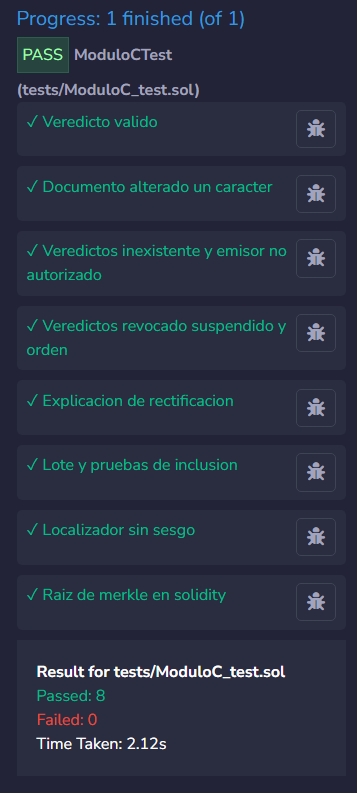

# Hito 3, Módulo C (Bloque 3): Seguridad, pruebas y gas

Equipo: Noé GUENGANT, Malo KERAUTRET, Lukas LAUDRAIN, Alex FOUGEROUX

Entrega: lunes 26 de octubre. Presentación: martes 27 de octubre.
Contrato de la semana: `VerificadorUBO.verificarConExplicacion` (ya funcionaba desde el hito 1).
Pruebas nuevas: `veredictosInexistenteYEmisorNoAutorizado`, `veredictosRevocadoSuspendidoYOrden`, `explicacionDeRectificacion`.

## 1. Pruebas automáticas: 8 de 8 en verde

Resultado en Remix con solo `tests/ModuloC_test.sol` marcado: **Passed: 8, Failed: 0, Time Taken: 2.12s**.



| Prueba | Qué comprueba | Resultado |
|--------|---------------|-----------|
| `veredictoValido` (ejemplo) | título correcto: `Valido` | ✓ |
| `documentoAlteradoUnCaracter` (ejemplo) | un carácter distinto: `DocumentoAlterado` | ✓ |
| `veredictosInexistenteYEmisorNoAutorizado` | un localizador nunca emitido da `Inexistente`; con `fijarPeriodo` empezando después de la fecha de emisión da `EmisorNoAutorizado` | ✓ (nueva) |
| `veredictosRevocadoSuspendidoYOrden` | `Suspendido`; `Revocado`; revocado con documento alterado sigue dando `Revocado`; revocado con emisor no autorizado da `EmisorNoAutorizado` (orden RN-06) | ✓ (nueva) |
| `explicacionDeRectificacion` | título revocado con `rectificadoComo = NUEVO12345`: `verificarConExplicacion` devuelve `Revocado` y el texto exacto con el nuevo localizador | ✓ (nueva) |
| `loteYPruebasDeInclusion` | lote de 2 hojas, prueba correcta y falsa, emisor no autorizado revierte | ✓ |
| `localizadorSinSesgo` | 7 bytes aceptados por símbolo; localizador determinista | ✓ |
| `raizDeMerkleEnSolidity` | 3 hojas, 1 hoja, 0 hojas | ✓ |

Para cambiar el estado de un título en las pruebas se añadió un auxiliar `_ponerEstado(loc, estado, nuevo)`: lee el título con `obtenerTitulo`, cambia `estado` y `rectificadoComo`, y lo vuelve a escribir con `fijarTitulo` del simulacro.

Las dos comprobaciones de orden de `veredictosRevocadoSuspendidoYOrden` son las que distinguen una implementación correcta de una que solo «funciona»: si `verificar` comprobara el compromiso antes que el estado, o el estado antes que el emisor, esta prueba fallaría.

Nota sobre la advertencia de tamaño: el compilador avisa que `ModuloCTest` mide 41 696 bytes (más de 24 576). Es el contrato de prueba, que incluye el código de creación de los 6 contratos que despliega en `beforeEach`. No se despliega en una red real. Los contratos del módulo compilan sin errores ni advertencias.

---

## 2. Lista de verificación de seguridad

La sección 7 del enunciado no estaba en el material disponible para el equipo. Esta lista se construyó con los puntos de seguridad del curso (Clase 1, «Seguridad común», y el foco del Bloque 3: suplantación de contrato, cifrado autenticado, segunda preimagen). Cada punto lleva la línea que lo cumple.

| # | Punto | ✓ | Dónde se cumple |
|---|-------|---|-----------------|
| 1 | Comprobar, modificar, interactuar: todas las comprobaciones antes de escribir estado | ✓ | `AnclajeLotes.anclarLote`, l. 48–50 (tres `revert`) antes de l. 52–55 (escritura y evento) |
| 2 | La llamada externa de `anclarLote` es de solo lectura | ✓ | l. 48: `registro.estaAutorizado(...)` es `view` (STATICCALL): el registro no puede reentrar ni cambiar estado |
| 3 | Control de acceso explícito en toda función que cambia estado | ✓ | l. 48: `if (!registro.estaAutorizado(msg.sender, facultad)) revert NoAutorizado(msg.sender, facultad);` |
| 4 | Se usa `msg.sender`, nunca `tx.origin` | ✓ | Ningún contrato del módulo usa `tx.origin`; l. 48 y l. 54 (`emisor = msg.sender`) |
| 5 | Autorización **actual** para anclar | ✓ | l. 48: `estaAutorizado` (un emisor revocado ya no puede anclar) |
| 6 | Autorización **histórica** para verificar | ✓ | `VerificadorUBO._veredicto`, l. 72: `registro.estabaAutorizado(t.emisor, t.facultad, t.fechaEmision)` |
| 7 | Orden obligatorio de los veredictos (RN-06) | ✓ | `_veredicto`, l. 71–78: Inexistente, EmisorNoAutorizado, Revocado, Suspendido, DocumentoAlterado, Valido. Probado por `veredictosRevocadoSuspendidoYOrden` |
| 8 | Errores personalizados en todas las reversiones (sin `require` con texto) | ✓ | `NoAutorizado`, `RaizInvalida`, `RaizDuplicada`, `LoteInexistente` (AnclajeLotes l. 19–22); `ByteNoAceptado`, `ListaVacia` (HerramientasSello l. 12–13) |
| 9 | Un evento por cada cambio de estado | ✓ | l. 55: `emit LoteAnclado(loteId, facultad, raiz, idCeremonia, msg.sender);` (`anclarLote` es la única función que escribe) |
| 10 | Raíz vacía rechazada | ✓ | l. 49: `if (raiz == bytes32(0)) revert RaizInvalida();` |
| 11 | Raíz repetida rechazada (no se puede anclar dos veces la misma ceremonia) | ✓ | l. 50 y l. 53: `_raizUsada` |
| 12 | Hoja con doble hash contra la segunda preimagen | ✓ | `ConstantesUBO.hojaLote`: `keccak256(bytes.concat(keccak256(abi.encode(loc, comp))))`, usada en `verificarInclusion` l. 67 |
| 13 | Pares ordenados compatibles con OpenZeppelin | ✓ | `HerramientasSello._hashPar`, l. 70; `MerkleProof.verifyCalldata`, l. 67 |
| 14 | Lote inexistente no responde `false` silenciosamente | ✓ | l. 66: `if (raiz == bytes32(0)) revert LoteInexistente(loteId);` |
| 15 | Localizador sin sesgo de módulo | ✓ | `HerramientasSello.byteAceptado`, l. 24: `return b < 252;`; `simboloDe`, l. 28 |
| 16 | El contrato no genera azar | ✓ | `derivarLocalizador(bytes32 semilla)`, l. 32: la semilla viene de fuera (CSPRNG del script) |
| 17 | Verificación sin billetera | ✓ | `verificar`, `verificarConExplicacion` y `verificarInclusion` son `external view` |
| 18 | Direcciones de los módulos no modificables | ✓ | `VerificadorUBO` l. 14–15 y `AnclajeLotes` l. 32: `immutable` |
| 19 | Sin desbordamientos aritméticos | ✓ | Solidity 0.8.20: aritmética comprobada por defecto |
| 20 | Contrato oficial comprobado (anti-suplantación) | ✓ | Fuera de la cadena: paso 1 de `verificarEnlace`, `e.sca.toLowerCase() !== direccionOficial.toLowerCase()`. Probado en el caso 3 |
| 21 | Cifrado autenticado del documento | ✓ | Fuera de la cadena: AES-256-GCM con IV nuevo por cifrado (`cifrarDocumento`). Probado en el caso 2 |
| 22 | Clave fuera del servidor | ✓ | La clave va en el fragmento `#k=` (RFC 3986, 3.5): `construirEnlace` |

---

## 3. Los siete casos de verificación: qué defensa actúa

El portal hace cuatro pasos: 1) `sca` oficial, 2) descifrar `ed` con `k`, 3) recalcular el compromiso y llamar a `verificar`, 4) comprobar el recibo de `tc`. Cada caso se detiene en una defensa distinta.

| Caso | Salida | Defensa que actúa | Dónde |
|------|--------|-------------------|-------|
| 1) enlace correcto | `Valido`, `transaccionConfirma: true` | Ninguna se activa: pasan los cuatro pasos | Todo el recorrido |
| 2) `ed` alterado | `EnlaceCorrupto` | **Cifrado autenticado**: la etiqueta de AES-GCM no coincide y el descifrado falla. No se llega a la cadena | Paso 2, fuera de la cadena |
| 3) contrato no oficial | `ContratoNoOficial` | **Ancla de confianza `sca`**: la dirección no es la oficial que publica la UBO. Se rechaza antes de leer nada | Paso 1, fuera de la cadena |
| 4) documento de otro título | `DocumentoAlterado`, `true` | **Compromiso con sal**: el documento del título 2 no da el compromiso registrado para el título 1 | Paso 3: `_veredicto`, l. 77 |
| 5) título revocado | `Revocado`, `true` | **Estado del título, antes que el compromiso** (orden RN-06) | Paso 3: `_veredicto`, l. 75 |
| 6) `tc` de otra transacción | `Valido`, **`false`** | **Comprobación del recibo**: el evento `TituloEmitido` de `tc` es del título 3, no del 4. `verificar` no puede detectarlo porque un contrato no lee recibos | Paso 4, fuera de la cadena. El portal no debe aceptar `Valido` si `transaccionConfirma` es `false` |
| 7) emisor no autorizado | `EmisorNoAutorizado`, `true` | **Autorización histórica**: el emisor no tenía un periodo que cubriera la fecha de emisión | Paso 3: `_veredicto`, l. 72 (`estabaAutorizado`) |

Conclusión: tres casos se detienen fuera de la cadena (2, 3 y 6) y tres dentro (4, 5 y 7). Ninguna capa basta sola: sin el paso 4, el caso 6 daría un título «válido» con una trazabilidad falsa.

Salida completa del script, ejecutado de principio a fin sin errores (compilador 0.8.20, optimización 200):


---

## 4. Gas: modo económico frente a modo completo

Medido con `escenario_moduloC.js` en Remix VM, compilador 0.8.20, optimización 200 (mismas cifras de despliegue que en el hito 2). Para la ceremonia de 50 se añadió temporalmente al script un segundo anclaje de 50 títulos, que se retiró después de la medida.

Extracto de la salida (ejecución con optimización 200):

```text
— Despliegue (con simulacros) —
✔ SimRegistroEmisores desplegado en 0xC114…403d — gas: 276021
✔ SimRegistroTitulos desplegado en 0x78FD8ffFc1 — gas: 734642
✔ VerificadorUBO desplegado en 0xB25f…a582 — gas: 611046
✔ AnclajeLotes desplegado en 0x7874…82b8 — gas: 431445
✔ HerramientasSello desplegado en 0x19a0…E6fC — gas: 483134
— Emisión y enlaces —
  · emitir CEBMFG9CHF — gas: 137212
  · emitir S6GQWAIGLJ — gas: 137212
  · emitir ZEESMTN4HG — gas: 137212
  · emitir 4FLPN5GUZ6 — gas: 137200
— Modo económico: ceremonia anclada con UNA raíz —
  raíz calculada por tu contrato igual a la de referencia: OK
  comprobación local de las 8 pruebas: OK
  · anclar ceremonia de 8 (1 tx) — gas: 149243
  inclusión del título 3: true
  [50] raíz del contrato igual a la de referencia: OK
  [50] comprobación local de las 50 pruebas: OK
  · anclar ceremonia de 50 (1 tx) — gas: 149243
  [50] inclusión del título 37: true (prueba de 6 hermanos)
```

| Ceremonia | Modo completo (N × `emitir`) | Modo económico (1 × `anclarLote`) | Gas por título (económico) | Proporción |
|-----------|------------------------------|-----------------------------------|----------------------------|------------|
| 8 títulos | 8 × 137 212 = 1 097 696 | 149 243 | ≈ 18 655 | 13,6 % (≈ 7,4 veces menos) |
| 50 títulos | 50 × 137 212 = 6 860 600 | 149 243 | ≈ 2 985 | 2,2 % (≈ 46 veces menos) |

- La prueba de inclusión pasa de 3 hermanos (8 títulos) a 6 (50 títulos). Se verifica con `verificarInclusion`, que es `view` y gratis.
- Pequeñas variaciones de gas (por ejemplo, un `emitir` de 137 200): la sal y la raíz son aleatorias, y cada byte cero del calldata cuesta 4 de gas en lugar de 16.

**Conclusión:** anclar cuesta lo mismo con 8 que con 50 títulos porque solo se guarda la raíz, así que el ahorro del modo económico crece con el tamaño de la ceremonia, a cambio de perder el estado por título.

---

## 5. ¿Cómo se anula un solo título emitido en modo económico?

Con la raíz sola no se puede: la raíz resume todos los títulos del lote, y cambiar una hoja cambia la raíz e invalida las pruebas de los demás. Hay que añadir algo.

| Opción | Qué se hace | Costo por título anulado | Qué complica |
|--------|-------------|--------------------------|--------------|
| A. Lista de revocación | `AnclajeLotes` guarda las hojas anuladas por lote; verificar exige estar en la raíz **y** no estar en la lista | Una transacción con una escritura nueva (≈ 45 000 de gas estimados: 21 000 de base + ≈ 22 100 de un `SSTORE` de cero a no cero + evento) | Decidir quién puede anular; la verificación tiene una lectura más (gratis, `view`) |
| B. Volver a anclar | Raíz nueva sin ese título; el lote viejo se marca como reemplazado | Un anclaje nuevo (≈ 149 000) + la marca del lote viejo | Todos los demás titulados necesitan pruebas y enlaces nuevos (7 en una ceremonia de 8, 199 en una de 200) |
| C. Registrar solo las excepciones | El título con incidencia se registra en `RegistroTitulos` (modo completo) y se revoca allí; los demás siguen solo en la raíz | Una emisión completa + una revocación (≈ 137 000 + 29 000) | Dos fuentes de verdad: el verificador debe saber cuál manda. Además contradice la regla «un mismo título nunca se emite en los dos modos» |

**Decisión: lista de revocación (A).**
**Razón:** es la más barata por título anulado, no toca a los demás titulados (sus enlaces y pruebas siguen valiendo) y mantiene una sola fuente de verdad dentro de `AnclajeLotes`. Quién puede anular: un emisor autorizado ahora en la facultad del lote, con la misma comprobación que `anclarLote` (l. 48), y un evento por cada anulación.
**Alternativas descartadas:** B obliga a redistribuir todos los enlaces de la ceremonia por un solo título; C duplica la fuente de verdad y mezcla los dos modos.
**Límite asumido:** el modo económico sigue sin suspensión ni rectificación por título. Para títulos que deben poder cambiar de estado se usa el modo completo, que es lo que recomienda el enunciado (económico para certificados masivos de bajo riesgo).

---

## 6. Modelo de amenazas: puntos que quedaban pendientes en el hito 1

| # | Amenaza | Estado en el hito 1 | Estado ahora |
|---|---------|---------------------|--------------|
| 1 | Contrato propio en `sca` | Pendiente, semana 3 | **Cerrada.** Defensa: paso 1 de `verificarEnlace`, que compara `sca` con la dirección oficial antes de leer nada. Demostrada por el caso 3 del script (`ContratoNoOficial`) |
| 3 | El enlace se reenvía o se filtra | Análisis pendiente, semana 3 | **Analizada.** El enlace es un título al portador: quien lo tenga lee el documento. La clave `#k` va en el fragmento y no llega al servidor (RFC 3986, 3.5), así que el portal no puede leer los datos, pero cualquier persona con el enlace completo sí. No permite falsificar: cambiar `ed` rompe el descifrado (caso 2) y cambiar el documento rompe el compromiso (caso 4). Respuesta si se filtra: el título no se puede «cambiar de clave» sin cambiar el compromiso, así que se rectifica (`rectificar` del modo completo: nuevo localizador, nueva sal, nuevo enlace) y `verificarConExplicacion` remite al nuevo localizador. Riesgo aceptado: un título es un documento que el titulado muestra a empleadores; el costo de evitarlo sería exigir billetera, que es lo que el proyecto quiere eliminar |